<picture>
  <source media="(max-width: 600px) and (prefers-color-scheme: dark)" srcset="assets/static/banner-dark-mobile.svg">
  <source media="(max-width: 600px) and (prefers-color-scheme: light)" srcset="assets/static/banner-light-mobile.svg">
  <source media="(prefers-color-scheme: dark)" srcset="assets/static/banner-dark.svg">
  <source media="(prefers-color-scheme: light)" srcset="assets/static/banner-light.svg">
  
</picture>

---

### Sobre mim

Sou desenvolvedor de software e bacharel em Ciência da Computação. Tenho experiência prática com PHP, JavaScript e APIs REST, além de manutenção e desenvolvimento de aplicações web na Zoe Tecnologia.

Também desenvolvi projetos acadêmicos envolvendo front-end, back-end, mobile e bancos de dados. Atualmente, sigo aprimorando minhas habilidades e explorando novas soluções em desenvolvimento de software.

---

### Habilidades técnicas

<picture>
  <source media="(max-width: 600px) and (prefers-color-scheme: dark)" srcset="assets/static/stack-dark-mobile.svg">
  <source media="(max-width: 600px) and (prefers-color-scheme: light)" srcset="assets/static/stack-light-mobile.svg">
  <source media="(prefers-color-scheme: dark)" srcset="assets/static/stack-dark.svg">
  <source media="(prefers-color-scheme: light)" srcset="assets/static/stack-light.svg">
  
</picture>

Ver em texto

- **Linguagens:** PHP*, JavaScript*, TypeScript, Python
- **Front-end e Mobile:** React, Next.js, React Native
- **Back-end e APIs:** Node.js, Express.js, Django, Django REST Framework
- **Banco de dados e ORM:** PostgreSQL, MySQL, SQLite, Prisma ORM
- **Ferramentas e automação:** Git, GitHub, GitHub Actions
- **Testes e aprendizado:** Vitest, React Testing Library

\* Experiência profissional. As demais vêm de projetos, cursos e estudo pessoal.

